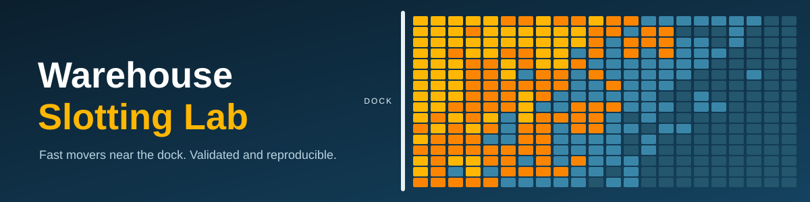
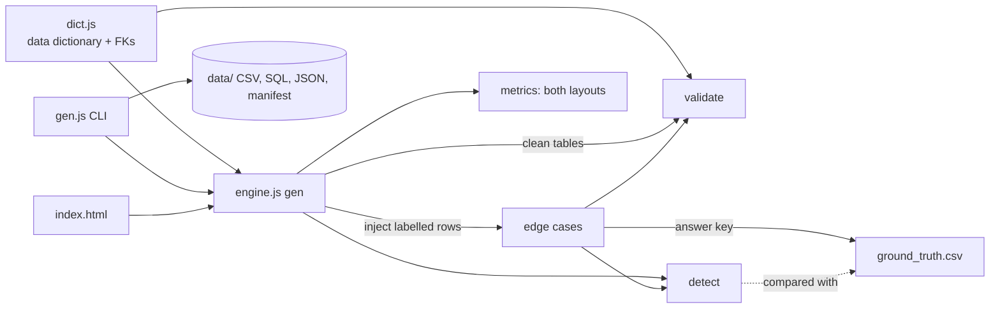
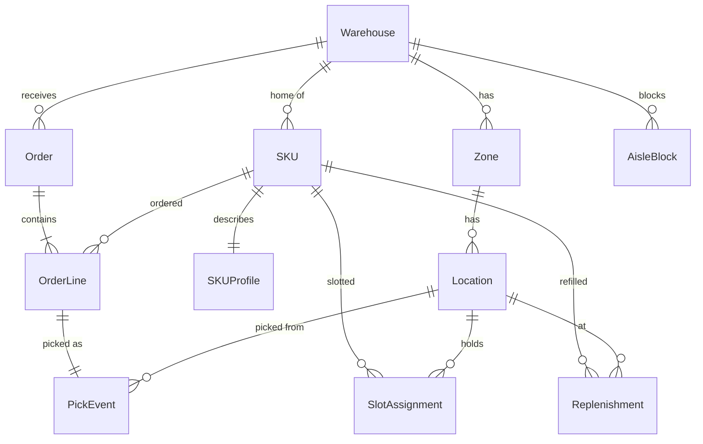

<p align="center"></p>

<p align="center">
<b>Put the right SKU in the right slot, then prove it with numbers.</b><br>
Seeded synthetic warehouse data, velocity-based slotting, validation, labelled edge cases and a browser UI. Zero dependencies.
</p>

<p align="center">


</p>

<p align="center">
<a href="https://punitpritam788.github.io/warehouse-slotting/"><b>Live demo</b></a> &nbsp;|&nbsp;
<a href="#-quick-start">Quick start</a> &nbsp;|&nbsp;
<a href="#-results">Results</a> &nbsp;|&nbsp;
<a href="DATA_DICTIONARY.md">Data dictionary</a> &nbsp;|&nbsp;
<a href="PROMPTS.md">AI disclosure</a>
</p>

## ✨ Highlights

| 🚚 **-47.3%** | 📦 **+14.8%** | ✅ **0** | 🎯 **50 / 50** | 🔁 **100%** |
|:---:|:---:|:---:|:---:|:---:|
| pick distance | lines per labor hour | validation failures | injected issues found | same-seed reproducible |

<sub>Full scale: 20 warehouses, 10,000 locations, 5,000 SKUs, 100,000 order lines, seed 20261022. The live page is available once GitHub Pages is enabled (main, folder /).</sub>

## 🚀 Quick start

Requires Node 18+. No install step, no dependencies.

```bash
git clone https://github.com/Punitpritam788/warehouse-slotting && cd warehouse-slotting
node gen.js                 # starter: 4 warehouses, 800 locations, 400 SKUs, 4,000 order lines (<1 s)
node gen.js --large         # 40 warehouses, 20,000 locations, 10,000 SKUs, 400,000 lines (~1.1M rows, ~17 s)
node gen.js --full          # 20 warehouses, 10,000 locations, 5,000 SKUs, 100,000 order lines (~6 s)
node gen.js --full --seed 7 --out /tmp/x --sql --json   # other seed, other folder, extra formats
```

| Flag | Meaning |
|---|---|
| `--full` / `--large` / `--starter` | scale preset (default starter) |
| `--seed N` | PRNG seed (default 20261022) |
| `--warehouses --locations --skus --lines --inject N` | override any scale parameter |
| `--out DIR` | output folder (default `data/<scale>`) |
| `--sql` / `--json` | also write `seed.sql` (DDL + inserts) / `all.json` |

The command prints counts, validation failures, anomaly detection vs ground truth and the reproducibility check, and exits non-zero if anything fails. That exit code is the one-line way to verify the solution.

Web UI: open `index.html`, pick a scale and click **Generate**. Use the **Modern / Classic** switch in the top bar to change layout (remembered in your browser, or add `?view=classic` to the URL). Scales: starter, full and a 400k-line large stress test. It runs the same engine in the browser, twice, and shows byte-for-byte equality, the baseline vs optimized comparison, every validation check and the injected edge cases. It can also download each table as CSV and the SQL seed.

## 📊 Results

Full scale, seed 20261022 (from `data/full/manifest.json`). Both layouts are replayed against the **same** 100,000 order lines.

| Metric | Baseline (random compatible fit) | Optimized (velocity ranked, nearest fit) | Change |
|---|---:|---:|---:|
| Total pick distance (m) | 4,892,814 | 2,578,170 | **-47.3%** |
| Avg distance per line (m) | 48.93 | 25.78 | -47.3% |
| Avg distance, class-A SKUs (m) | 49.18 | 22.00 | -55.3% |
| Replenishment tasks | 39,471 | 40,445 | +2.5% |
| Replenishment labor (min) | 271,860 | 253,739 | -6.7% |
| Peak-day replen labor / capacity | 1.11 | 1.31 | |
| Lines per labor hour | 15.39 | 17.67 | **+14.8%** |

Reading it: putting fast movers near the dock cuts walking by almost half and lifts throughput by about 15%. Replenishment task count barely moves (slot capacity, not location, drives it) and total labor drops a little. The peak-day ratio is the least stable number: capacity is calibrated on the actual timeline (baseline until Jun 30, optimized after), so a replay of one layout over the whole year can land above or below 1.0 depending on the seed (here 1.11 baseline vs 1.31 optimized). Treat it as indicative, not as a result. Throughput assumes walking 1.2 m/s, 30 s handling per line, round trip to the dock.

| Check | Result |
|---|---|
| Rows (full) | Warehouse 20 · Zone 80 · Location 10,000 · SKU 5,000 · SKUProfile 5,000 · Order 33,505 · OrderLine 100,000 · PickEvent 100,000 · Replenishment 39,122 · SlotAssignment 10,030 · AisleBlock 70 · ground truth 50 |
| Validation failures (clean data and after injection) | 0 |
| Detector rows on clean data | 0 |
| Injected edge cases vs detector | 50 expected, 50 found, 0 false positives, 0 false negatives |
| Two runs, same seed | identical in every table |

## 🏗️ Architecture



- `dict.js` is the single source of truth: field types, units, enums and rules, plus foreign keys. It produces `DATA_DICTIONARY.md` and the SQL DDL, and it drives validation, so documentation and checks cannot drift apart.
- `engine.js` holds the generator, validator, detector and exporters. It has no dependencies and runs unchanged in Node and in the browser.
- The detector reads only the input tables. It never reads the ground truth, so the answer key cannot leak into it.

## 🗂️ Data model



The ten entities from the brief plus `AisleBlock` (needed to model "pick path uses blocked aisle"). Full field list with types, units, allowed values and rules: [`DATA_DICTIONARY.md`](DATA_DICTIONARY.md).

- **Cardinality:** SKU to SKUProfile is 1:1; OrderLine to PickEvent is 1:1; Zone to Location is 1:N. SKU to Location is N:M over time and is carried by the bridge table `SlotAssignment`, which has effective dates.
- **IDs:** `WH-001`, `LOC-<zone-id>-000001`, `SKU-000001`, `ORD-2026-000001`, `PICK-<order-id>-001`, `SLOT-2026-000001`. Added: `REPL-2026-000001`, `BLK-2026-000001`. Counters are zero padded and IDs are never reused.
- **Lifecycle and history:** slots are never overwritten. A slot is `ACTIVE` while it has no end date and becomes `SUPERSEDED` when the end date is set. Baseline slots run 2026-01-01 to 2026-06-30, optimized slots start 2026-07-01.

## ⚙️ Generation logic

Order of creation: Warehouse, Zone, Location, SKU, Order and OrderLine, SKUProfile, SlotAssignment, PickEvent, Replenishment, AisleBlock, then injected edge cases. Child rows only reference parents that already exist.

| Step | Rule |
|---|---|
| Layout | each warehouse has 4 zones (60% AMBIENT, 12% COLD, 10% HAZMAT, 18% BULK); 60 locations per aisle (20 bays x 3 levels); location size and weight limit depend on zone and level |
| SKU mix | 5% oversized, 8% hazard (flammable or corrosive), 10% cold chain, rest ambient; about 10% of ambient SKUs are bulky and 5% heavy so fit matters |
| Demand | Zipf-like popularity per warehouse; two peak windows (Mar 1-15, Sep 15 - Oct 11) at 3x order volume, with 10% "seasonal" SKUs at 6x during peaks |
| Velocity class | derived from realised order lines: A until 80% of lines, B until 95%, C after |
| Compatibility | oversized only in BULK, hazard only in HAZMAT, cold only in COLD, other goods in AMBIENT; the SKU must also fit the location (length, width, height, weight, no rotation) |
| Baseline slotting | velocity-blind: random compatible free location |
| Optimized slotting | hottest SKU first, nearest compatible free location to the dock |
| Pick | `PickEvent.location_id` is the slot in force on `picked_at`; travel distance is 2 x dock distance |
| Replenishment | when stock falls to 25% of slot capacity, refill to capacity; labor = 5 + 0.1 x qty + 0.05 x dock metres (minutes) |
| Labor capacity | per warehouse, 115% of its busiest replenishment day |
| Derived values | order totals, picks_total, velocity class, volumes, distances and labor are computed from source rows, never drawn independently |

## 🧪 Edge cases and ground truth

Clean data is generated and validated first. Edge cases are then added as **new labelled rows** and never by editing valid rows. Ten per type at full scale (two at starter scale).

| `issue_type` | How it is injected | Detector rule |
|---|---|---|
| `SKU_EXCEEDS_LOCATION_CAPACITY` | extra slot in a free location the SKU does not fit | dimension or weight check |
| `INCOMPATIBLE_COLOCATED` | hazard or cold SKU slotted in the wrong zone type | SKU class vs zone type |
| `DUPLICATE_ACTIVE_LOCATION` | second SKU on a location that is already active | overlapping slot dates on one location, later slot flagged |
| `PICK_USES_BLOCKED_AISLE` | an `AisleBlock` over a day on which exactly one pick used that aisle | pick date inside a block window |
| `REPLEN_EXCEEDS_LABOR_CAPACITY` | extra replenishment tasks until one warehouse-day passes capacity | daily labor sum above capacity |

`ground_truth.csv` lists `issue_id, issue_type, entity_type, entity_id, note`, where the note states the expected decision (reject, re-route, rebalance). Each injected case is built so that only its own rule fires; the comparison reports true positives, false positives and false negatives.

<details>
<summary><b>✅ Validation</b> (click to expand)</summary>

`engine.js > validate` runs 60+ checks, all driven by `dict.js`:

- primary-key uniqueness for every table and no repeated SKU within an order and foreign-key integrity for every relationship
- required fields, types and allowed enum values
- ID format for every table
- date ordering (order <= pick <= shipped, slot start <= end, block start <= end)
- arithmetic reconciliation: location volume and dock distance, SKU volume and oversize flag, order totals vs lines, `picks_total` vs lines, velocity class recomputed, pick distance, replenishment labor
- warehouse consistency across SKU, order, location, pick and slot
- lifecycle: `ACTIVE` if and only if no end date; every pick and replenishment location equals a slot in force on that date

Business-rule violations (the five edge-case types) are deliberately **not** structural errors, so they pass validation and are found by the detector instead.

</details>

## 🔁 Reproducibility

One PRNG (mulberry32) seeded with 20261022, no `Math.random`, no wall-clock dates. `gen.js` generates the data twice in the same run and compares every table, and the manifest stores a SHA-256 and an FNV-1a checksum per table. Re-running with the same seed on the same Node version gives identical files.

<details>
<summary><b>🧠 Assumptions and trade-offs</b> (click to expand)</summary>

- **One SKU per slot, fixed orientation.** Keeps fit checks and duplicate detection unambiguous.
- **Manhattan distance to a single dock.** Enough to compare layouts like for like; a full pick-path simulation was out of scope.
- **Baseline is random, not an existing real layout.** A random compatible placement is the neutral "no velocity logic" reference.
- **One big-bang re-slot on 2026-07-01.** Makes before/after visible in the event history. Move labor is not costed.
- **Capacity is derived, not set.** Labor capacity comes from the simulated workload so valid days never exceed it and injected days always do.
- **Edge cases are additive rows.** Safer than corrupting valid rows and keeps the ground truth exact.
- **No external data.** Nothing to license or attribute.

</details>

<details>
<summary><b>⚠️ Limitations</b> (click to expand)</summary>

- No multi-slot or forward/reserve pick faces, and no rotation of items.
- "Blocked aisle" is checked on the aisle of the pick location, not along a routed path.
- The optimizer ignores slot capacity, ergonomics (shelf level) and co-pick affinity.
- Replenishment is a simple refill-to-capacity rule with no batching.
- Seasonality is a single flat multiplier during two windows.
- Results depend on the synthetic parameters; they show the mechanism, not a prediction for a real site.

</details>

## 🤖 AI use

This project was built with an LLM (Claude). The prompts are in [`PROMPTS.md`](PROMPTS.md) together with what the AI produced and what I reviewed and verified. Verification: `node gen.js` and `node gen.js --full` pass all checks, and `index.html` was loaded in headless Chromium with the same results.

## 📁 Repo layout

```
index.html            modern web UI (loads dict.js + engine.js)
session.js           generation session shared by the Web Worker and the main-thread fallback
worker.js             Web Worker entry (keeps the page responsive on big runs)
engine.js             generator, validator, detector, exporters
dict.js               data dictionary, foreign keys, DDL and markdown generators
gen.js                CLI: generate, validate, write files, check reproducibility
DATA_DICTIONARY.md    generated field reference
PROMPTS.md            prompt history and AI disclosure
PROMPT.md             three detailed prompts that reproduce this repo (written afterwards)
data/starter/         all outputs for the starter scale
data/full/            CSV + ground_truth.csv + manifest.json for the full scale
```

## 📜 License and data provenance

All data is generated by this code; no third-party datasets were used. Add a `LICENSE` file of your choice before sharing widely.

## Handling big data in the browser

- **Background thread:** generation runs in a Web Worker (`worker.js`), so the page stays responsive. If workers are unavailable (for example opening the file directly from disk), it falls back to the main thread.
- **Progress and cancel:** eight named stages drive a progress bar, and Cancel terminates the worker immediately.
- **Data stays in the worker:** the UI only receives a small summary (metrics, checksums, 50 ground-truth rows, heatmap cells). The data explorer pages 20 rows at a time, and CSV/SQL are built only when you click a download button.
- **Verification is optional:** "generate twice" doubles time and memory, so it is off by default for the large preset.
- **Measured:** full scale takes about 3 s per run; the large preset (about 1.1 million rows) takes about 17 s per run in Node and passes every check.
